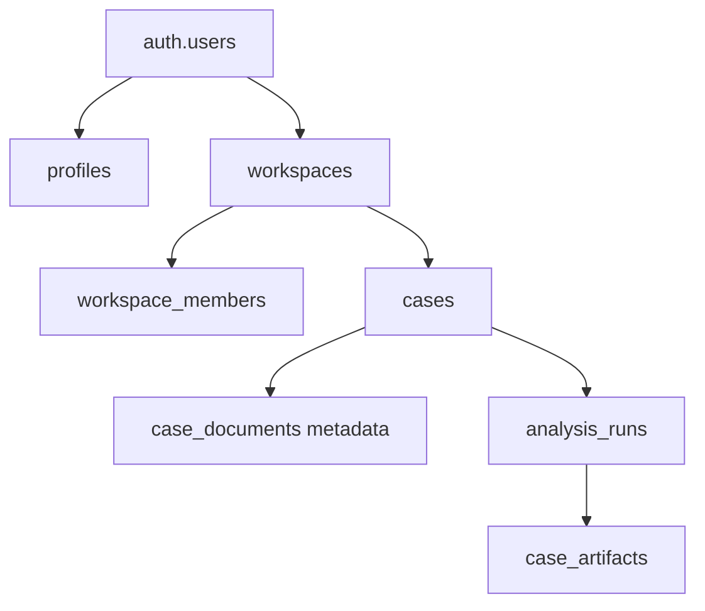
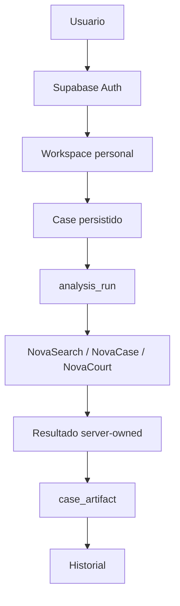

# Fase 2.1 - Fundacion de identidad e historial

## Estado

Esta entrega incorpora una base inicial de Auth, workspaces, casos, ejecuciones y snapshots. **No se declara cerrada**: la migration, grants, RLS y Storage requieren validacion real en Postgres/Supabase. La integracion de documentos con Storage privado ya esta conectada en el backend cuando `ApplicationRepository` esta configurado; produccion falla cerrada si no esta disponible.

## Arquitectura implementada

- Vue usa `@supabase/supabase-js` para signup, signin, signout, restauracion de sesion, recuperacion y cambio de contrasena. Las peticiones privadas adjuntan el bearer.
- Flask valida el bearer con Supabase Auth `/auth/v1/user` y deriva el UUID del usuario de la respuesta validada.
- `APP_SUPABASE_SERVICE_ROLE_KEY` es solo de servidor. `ApplicationRepository` agrega scope del usuario/workspace a sus consultas porque el service key evita RLS.
- El task journal y el corpus de documentos de Fase 1 siguen en SQLite. Si la integracion de aplicacion esta configurada, los cambios de task se sincronizan a `analysis_runs` y los resultados server-owned completados se copian a `case_artifacts`.

## Auth y bootstrap

- La identidad canonica es `auth.users.id`; no se guardan contrasenas en MYKE.
- La migration instala un trigger idempotente para crear `profiles`, un workspace personal y la membresia `owner`. El nombre de metadata se usa solo como etiqueta.
- Auth de frontend expone registro, inicio/cierre de sesion, confirmacion pendiente, solicitud de reset y actualizacion de contrasena. La entrega de email no se probo.
- En desarrollo, `local-development-user` requiere `LOCAL_DEV_AUTH_ENABLED=true`; con bearer siempre se valida el token y un token invalido no cae al usuario local. Produccion rechaza esa bandera. El modo Flask `TESTING` usa identidad determinista unicamente para pruebas.
- La pantalla MYKE es la ruta de login y de trabajo existente. Las rutas legacy privadas tienen guard de sesion.

## Modelo de datos y migracion

La migration creada por `supabase migration new auth_workspace_history_foundation` define:

- `profiles`: datos de presentacion ligados a `auth.users`.
- `workspaces`: tipos `personal` y `organization`, con indice unico parcial para un workspace personal por propietario.
- `workspace_members`: roles `owner`, `admin`, `member` y clave `(workspace_id,user_id)`.
- `cases`: UUID, workspace, creador, titulo, descripcion y estado `active`/`archived`.
- `analysis_runs`: herramienta, task, case/workspace, estado, parent run y metadata sin trazas.
- `case_artifacts`: snapshots con `schema_version`; escrituras de cliente revocadas y snapshots no reemplazados por conflicto.
- `case_documents`: metadata de Storage, case/workspace, nombre, MIME, bytes y estado.

Hay indices para membership, workspace/fecha, case/fecha, task, artifacts por run/case y documentos por case/workspace. RLS se activa en todas las tablas. Las politicas usan `auth.uid()` y membership propia; no usan `user_metadata` para autorizar. El unico `SECURITY DEFINER` es el trigger de bootstrap, con `search_path` vacio y ejecucion directa revocada.

## RLS y Storage

- Perfiles son de lectura/actualizacion propia.
- Workspaces y memberships son visibles segun propietario/membership.
- Casos permiten lectura/creacion/actualizacion de miembros, sin borrado directo.
- Runs, artifacts y metadata de documentos son de lectura para miembros; escrituras quedan reservadas al servidor.
- La migration define el bucket privado `case-documents`, 50 MiB, MIME permitidos, lectura por metadata y membership, e insercion solo bajo el path del workspace/case autorizado. Los usuarios no reciben update/delete de objetos.
- `supabase/tests/auth_workspace_rls.sql` incluye bootstrap, lecturas propias, intentos directos por ID y aserciones A/B sobre cases, runs, artifacts, metadata y objetos Storage. **No se ejecuto**: Docker Desktop no tenia disponible su pipe/daemon.

## Backend, casos e historial

- `/api/me` devuelve perfil y workspace personal.
- `GET/POST /api/cases`, `PATCH /api/cases/{id}`, `GET /api/cases/{id}/runs` y `GET /api/runs/{id}/result` son rutas autenticadas. El body no define el usuario.
- El repositorio aplica filtros por usuario/workspace con service key. Produccion requiere `APP_SUPABASE_SERVICE_ROLE_KEY`.
- `TaskManager` mantiene el task journal actual. El callback persiste estados a `analysis_runs` y artifacts finalizados a `case_artifacts` cuando el repositorio remoto esta disponible.
- NovaCase y NovaCourt comparten `case_id`; Court enlaza `parent_run_id` cuando encuentra el run padre.
- La UI Mis casos lista, abre, renombra y archiva casos y muestra runs NovaCase/NovaCourt. Para una ejecucion completada, el enlace usa `run_id` y `GET /api/runs/{id}/result`; NovaCase/NovaCourt presentan el artifact existente, sin iniciar un task ni invocar proveedores. Runs activos siguen usando la restauracion del journal operacional.
- La escritura y lectura de `analysis_runs`/`case_artifacts` estan implementadas via repositorio de servidor, pero su operacion contra Supabase real depende de configurar credenciales y aplicar la migration.

## Documentos

Los uploads siguen usando el endpoint compatible `/api/cases/{case_id}/documents`. Con `ApplicationRepository`, el backend valida el case, genera el `document_id` y el path, almacena el original y metadata principal en el bucket privado `case-documents` y sirve descargas tras autorizacion. En produccion, si no hay repositorio configurado, upload responde 503. SQLite conserva el manifiesto de extraccion, texto normalizado, chunks y vectores usados por la busqueda documental existente; ya no es autoridad del binario ni del ownership/metadata principal. En desarrollo sin repositorio puede mantenerse el modo legacy local.

## Configuracion y entorno

- CLI observado: Supabase `2.53.6`. Se consultaron `supabase init`, `supabase migration new`, `supabase test db` y la documentacion oficial vigente de Auth, RLS y Storage.
- `supabase/config.toml` fue generado por el CLI; auth local requiere confirmacion de email y usa redirect local en `http://localhost:5173`.
- Frontend: `VITE_SUPABASE_URL`, `VITE_SUPABASE_PUBLISHABLE_KEY`.
- Backend: `SUPABASE_URL`, `SUPABASE_PUBLISHABLE_KEY` para validar Auth; `APP_SUPABASE_SERVICE_ROLE_KEY` solo en servidor. Las claves existentes del motor juridico conservan su alcance.
- Produccion necesita redirects Auth, SMTP verificado, secretos del servidor y aplicar migrations mediante el proceso operativo aprobado. Esta tarea no modifico un proyecto remoto.

## Validacion ejecutada

- Los conteos de la ejecucion base se conservan en el reporte de Fase 2.1. La validacion actualizada de Fase 2.1B esta en `docs/PHASE_2_1B_REAL_VALIDATION.md`.
- CLI observado: Supabase `2.53.6`; `supabase status`, `docker version` confirmaron que el CLI existe pero Docker Desktop no expone `//./pipe/dockerDesktopLinuxEngine`. No se aplico ni reseteo una base local.

## Limitaciones conocidas

1. La migration, RLS, grants y Storage no fueron comprobados en Postgres local/remoto; no se declara aislamiento A/B de base de datos como PASS.
2. La entrega real de confirmacion/reset de correo requiere Supabase local/Inbucket o SMTP configurado.
3. Las migraciones, grants, RLS/Storage policies y callbacks de persistencia no se probaron contra Postgres/Supabase real; por ello aislamiento y persistencia externa siguen sin validacion operacional.
4. Signup, confirmacion y password reset no se probaron mediante Auth/Inbucket real. SMTP externo no fue utilizado.
5. Reabrir artifacts completados ya tiene ruta UI/API; la base remota ausente impide probar persistencia luego de logout/login/reinicio.
6. SQLite sigue siendo indice de extraccion/chunks para el corpus documental; el original y metadata principal se guardan en Storage/Supabase solo con repositorio configurado.

## Limites de Fase 2.1

No se implementan pagos, planes, cuotas, colas, workers distribuidos, escalado, equipos/invitaciones, SSO propio, MFA propio ni consola de administracion. `organization` y roles preparan una extension futura, pero no hay colaboracion.

## Fase 2 - integration boundaries

- Auth entra por el middleware Flask `Authorization: Bearer`; la identidad se deriva del usuario validado y nunca del body.
- El workspace se resuelve por propietario/membership. No autorizar mediante metadata editable.
- `cases.id` es el `case_id` comun. No crear otro ID de expediente.
- `analysis_runs` conecta `task_id`, `tool`, `case_id` y `parent_run_id`; artifacts son snapshots server-owned versionados.
- El endpoint de documentos valida scope y conecta original/metadata al bucket privado; SQLite se limita a los datos derivados que consume el pipeline existente.
- Endpoints de tasks, documentos, resultados y exports deben validar usuario y scope antes de operaciones con credenciales privilegiadas.
- No alterar `case_id`, `task_id`, `document_id`, `source_id`, IDs del grafo, contratos de resultados, rutas API ni estados de tasks para agregar user/workspace.
- Historial completado se recupera por `run_id` desde artifacts del servidor sin volver a ejecutar NovaSearch, NovaCase, NovaCourt o Graph.
